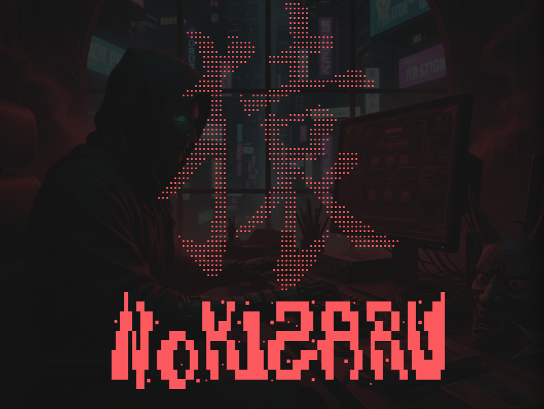

<p align="center">
  
</p>

<p align="center">


</p>

Nokizaru is a CLI tool purpose-built for enumerating the core web recon surface. Its goal is to provide a sufficiently expansive, high-signal overview of a target quickly, subverting the need to reach for heavier OSINT suites. Instead of running several tools in sequence, Nokizaru aims to produce comparable recon results with a single full-scan command. The ideal use case is collecting relevant information on a web target during the recon phase of a bug bounty or web app pentest engagement. As such, the primary audience is security researchers (not CTI analysts who may still prefer larger, more comprehensive OSINT suites).

> [!CAUTION]
>
> *Nokizaru is intended for authorized security testing and research. Always ensure you have explicit permission to scan targets you do not own.*

---

## Architecture

Nokizaru runs a full web recon pass with shared target context, bounded or adaptive module execution, and graceful degradation when targets are slow, hostile, or heavily canonicalized. Healthy full directory scans complete their finite plan without a fixed total budget.

### Context-Aware Scanning Pipeline

- **Headers -> Target Profile:** response headers shape later scan behavior, including redirect and canonical host hints
- **Custom Headers:** repeatable `-H/--header` values are reused across in-scope web requests without printing secrets back to stdout
- **Re-Anchoring:** crawler and directory scans can automatically move to the effective in-scope URL, such as HTTP -> HTTPS or canonical same-scope hosts
- **Crawler -> Dir Enum:** crawler discoveries seed directory checks so high-signal paths are tested before lower-value wordlist noise
- **Dir Enum Noise Control:** WAF/soft-404-heavy responses are kept inspectable in exports, but stdout favors actionable paths over bulk false positives
- **Port Scan Context:** port checks are native TCP probes with lightweight service/category/TLS/HTTP/exposure hints
- **Wayback Snapshots:** host-scoped archive history selects up to five snapshots each near 3 months, 6 months, and 1 year, then fills a 50-result cap with high-signal changes

---

## Installation

Nokizaru builds to a single binary with no runtime dependencies.

### Build From Source (Git Clone)

Requires [Crystal](https://crystal-lang.org/install/) `>= 1.21.1`. The toolchain and the `just` task runner are pinned with [mise](https://mise.jdx.dev/).

```bash
git clone https://github.com/hakkuri01/nokizaru.git
cd nokizaru
mise trust && mise install   # pins crystal + just
just setup                   # builds the pinned Ameba linter (dev only)
just build                   # produces bin/nokizaru
./bin/nokizaru --help
```

Without mise, build directly with the Crystal compiler:

```bash
crystal build --release src/nokizaru.cr -o bin/nokizaru
```

Put `bin/nokizaru` on your `PATH`.

### Nix

The root flake supports `aarch64-linux` and `x86_64-linux`, with nixpkgs pinned
to a Crystal 1.21.1 toolchain:

```bash
nix build
./result/bin/nokizaru --help
nix develop       # Crystal, shards, just, OpenSSL, and the pinned Ameba
just verify       # offline; the shell installs bin/ameba, no just setup needed
```

`nix flake check` runs formatting, lint, specs, unreachable-code detection, the
release build, and offline CLI smoke tests. Nix may fetch the pinned inputs and
build dependencies first. The package embeds its data and has no runtime shards;
its linked system libraries are managed by Nix. See [CONTRIBUTING.md](CONTRIBUTING.md#nix)
for the development workflow.

---

## Configuration

### Provider Availability

- **crt.sh:** Quarantined from default scans due to its documented backend/database rebuild and expected degraded service until the upstream rebuild stabilizes. Nokizaru retains the adapter, tracks recovery, and will re-enable it only after a reliability and unique-value canary passes.
- **ThreatMiner:** Quarantined after a chronic API outage with no successor endpoint.

### API Keys

Some providers use optional API keys. Missing credentials skip only that provider; architecture fingerprinting is skipped entirely without a Wappalyzer key.

#### Environment Variables

Keys are read from environment variables if they are set; otherwise they are loaded from `${XDG_DATA_HOME:-$HOME/.local/share}/nokizaru/keys.json`.

```bash
NK_ALIENVAULT_KEY, NK_BEVIGIL_KEY, NK_BINEDGE_KEY, NK_CENSYS_API_ID, NK_CENSYS_API_SECRET,
NK_CHAOS_KEY, NK_FB_KEY, NK_HUNTER_KEY, NK_NETLAS_KEY,
NK_SHODAN_KEY, NK_VT_KEY, NK_WAPPALYZER_KEY, NK_ZOOMEYE_KEY

# Example :
export NK_SHODAN_KEY="kl32lcdqwcdfv"
```

#### Saved Keys

Use **`-k`** to add keys, saved automatically in the user data directory. With only the key name, Nokizaru prompts for the key without echoing it (or reads it from piped stdin), so it stays out of your shell history.

```bash
# Usage
nokizaru -k '<API NAME>'

Valid Keys : 'alienvault', 'bevigil', 'binedge', 'censys_api_id', 'censys_api_secret', 'chaos', 'facebook', 'hunter', 'netlas', 'shodan', 'virustotal', 'wappalyzer', 'zoomeye'

# Example :
nokizaru -k shodan
```

`Path = ${XDG_DATA_HOME:-$HOME/.local/share}/nokizaru/keys.json`

### JSON Config File

The default config file is `${XDG_CONFIG_HOME:-$HOME/.config}/nokizaru/config.json`.

```json
{
  "common": {
    "timeout": 30,
    "dns_servers": "8.8.8.8, 8.8.4.4, 1.1.1.1, 1.0.0.1"
  },
  "ssl_cert": {
    "ssl_port": 443
  },
  "port_scan": {
    "threads": 50
  },
  "dir_enum": {
    "threads": 50,
    "redirect": false,
    "verify_ssl": false,
    "extension": ""
  }
}
```

---

## Usage

```bash
Nokizaru - Recon Refined

Arguments:
  -h, --help       Show this help message and exit
  -v, --version    Show version number and exit
  --target TARGET  Target (http[s]://host[:port])
  --headers        Header Information
  --sslinfo        SSL Certificate Information
  --whois          Whois Lookup
  --crawl          Crawl Target
  --dns            DNS Enumeration
  --sub            Sub-Domain Enumeration
  --arch           Architecture Fingerprinting
  --dir            Directory Search
  --wayback        Wayback Snapshots
  --ps             Fast Port Scan
  --full           Full Recon
  --no-[MODULE]    Skip specified modules above during full scan (eg. --no-dir)
  --export         Write results to export directory
  --tui            Force the interactive dashboard (and the command form)

Extra Options:
  -nb          Hide Banner
  -dt DT       Number of threads for directory enum [ Default : 50 ]
  -pt PT       Port scan concurrency [ Default : 50 ]
  -p PORTS     Port scan ports [ Example : 80,443,1000-65535 ]
  -T T         Base timeout / module budget [ Default : 30.0 ]
  -w W         Wordlist size (small, medium, large) or custom path [ Default : medium ]
  -H, --header HEADER  Add custom request header (repeatable)
  -r           Follow redirects during directory enum [ Default : False ]
  -s           Enable SSL verification for directory enum [ Default : False ]
  -sp SP       Specify SSL Port [ Default : 443 ]
  -d D         Custom DNS Servers [ Default : 8.8.8.8,8.8.4.4,1.1.1.1,1.0.0.1 ]
  -e E         File Extension(s) (comma separated) [ Example : txt,xml,php,etc. ]
  -o O         Export Format(s) (comma-separated) [ Default : txt,json,html ]
  -cd CD       Export directory for this run (requires --export)
  -of OF       Export filename base for this run (requires --export)
  -k K         Add API key, prompted without echo [ Example : shodan ]
```

### Examples

```bash
# Full scan
nokizaru --full --target https://example.com

# Directory enumeration with extensions and a custom wordlist
nokizaru --dir --target https://example.com -e txt,php -w /path/to/wordlist

# Directory enumeration with a curated wordlist size
nokizaru --dir --target https://example.com -w large

# Port scan a custom port set
nokizaru --ps --target https://example.com -p 80,443,8000-8010

# Authenticated crawl + dir enum with a session cookie
nokizaru --crawl --dir --target https://example.com \
  -H 'Cookie: PHPSESSID=abc123; uid=52' \
  -H 'X-Role: admin'
```

Custom headers are applied only to in-scope target requests. Nokizaru does not echo supplied header values back in module banners.

Directory enumeration ships curated `small` (2K), `medium` (5K), and `large` (10K) wordlists, embedded in the binary. `medium` is the default; `-w` also accepts any custom wordlist path.

### Interactive Dashboard

On a terminal, Nokizaru runs as a full-screen app. There are two ways in:

- **Bare launch** (`nokizaru`, no scan flags): an opening screen reveals the banner and wordmark; press any key to reach a vim-style command form that collects the target, the modules, and the option and export switches, building a live `nokizaru …` command at the foot. `enter` runs the scan.
- **Power-user override** (`nokizaru <scan args>`, e.g. `nokizaru --full --target https://example.com`): skips the opener and the form and launches straight into the running dashboard. Press `q` twice (`qq`) to drop back to the terminal and run another scan. Add `--tui` to force the command form instead, prefilled from your flags.

Results stream into one tab per module, plus a Summary tab. When a scan finishes, browse the tabs. Results are not printed to the terminal on exit; use `--export` to save them.

| Mode | Key | Action |
| --- | --- | --- |
| Form (NORMAL) | `j`/`k`, `↑`/`↓` | Move between fields |
| Form (NORMAL) | `←`/`→` | Move across the module chips |
| Form (NORMAL) | `space` | Toggle the field or focused module |
| Form (NORMAL) | `i` | Edit a text or number field |
| Form (NORMAL) | `h` | Open the flag and key reference (`q` or `h` closes it) |
| Form (NORMAL) | `enter` | Run the scan |
| Form (NORMAL) | `q` | Quit |
| Form (INSERT) | type, `←`/`→`, `home`/`end` | Edit; `enter` runs, `esc` returns to NORMAL |
| Dashboard | `tab`/`shift+tab`, `h`/`l`, `←`/`→`, `1`-`9`/`0` | Switch module tab |
| Dashboard | `j`/`k`, `ctrl+d`/`ctrl+u`, `pgdn`/`pgup`, `g`/`G` | Scroll the results within the pane |
| Dashboard | `f` | Follow the running module |
| Dashboard | `q` | Interactive launch: back to the form (stops a running scan). Power-user launch: press again to exit to the terminal |
| Anywhere | `ctrl+c` | Quit |

The app does not capture the mouse, so a plain drag selects and copies text, and the wheel scrolls the results. Piped or redirected runs (for example `nokizaru --full --target https://example.com --export | tee scan.txt`) skip the app and print the classic line output.

---

## Output / Exports

Scan results are not persistent by default, although Nokizaru maintains its configuration, key store, and runtime log. If you specify `--export`, it writes **TXT**, **JSON**, and **HTML** reports unless you narrow formats with `-o`.

By default, exports are written to:

```bash
${XDG_DATA_HOME:-$HOME/.local/share}/nokizaru/exports/<hostname>/
├── YYYY-MM-DD_HH-MM-SS.txt
├── YYYY-MM-DD_HH-MM-SS.json
└── YYYY-MM-DD_HH-MM-SS.html
```

Exports are grouped by hostname and use timestamped filenames. Override the directory with `-cd` or the filename base with `-of`.

---

## Roadmap

- **Headless mode (`--headless`):** a no-TUI, no-TTY run for AI-agent and automation workflows. Structured results to `-o`/exports or stdout, progress and errors on stderr, an exit code for chaining, the same engine and flag grammar. (Piped runs already produce the classic line output today; `--headless` will make that an explicit, TTY-independent contract.)
- **Prebuilt binaries** for the Crystal release.
